# Garblo — Báo cáo điều tra AS-IS UX (FE-only)

**Ngày điều tra:** 30/10/2026  
**Snapshot source:** commit `1e15048618de5609ae0b90fef92d25ac9ca7eb53`; working tree sạch trước khi tạo báo cáo.  
**Phương pháp:** một sub-agent Screen Discovery; sau khi discovery hoàn tất, 12 sub-agent điều tra, mỗi agent một màn hình, chạy song song theo ba nhóm bốn; agent chính đối soát source, transition và loại bỏ kết luận trùng.  
**Phạm vi:** phân tích tĩnh frontend; không suy đoán backend, không coi text cam kết là bằng chứng nghiệp vụ đã chạy. Không thực hiện kiểm thử trình duyệt trong cuộc điều tra này.

## 1. Kết luận điều hành

Garblo hiện có **5 tab destination, 7 màn hình nội dung chính, 5 màn hình overlay toàn khung và 4 bottom sheet**. Theo tiêu chí màn hình có bố cục/nhiệm vụ riêng, tổng là **12 màn hình**, cộng 4 sheet tác vụ; không phải chỉ ba màn hình. Inventory được xác định từ component và dispatcher thực tế, không từ tên task trong tài liệu (`src/App.tsx:3–12`, `src/App.tsx:142–543`, `src/App.tsx:573–588`).

Ứng dụng điều hướng bằng React state, mở mặc định ở Tủ đồ; không có URL route/deep-link sản phẩm được triển khai trong entry và dispatcher đã đọc (`src/main.tsx:1–10`, `src/App.tsx:545–590`). Các thao tác FE như chuyển tab, mở overlay, quẹt thẻ, đổi lựa chọn và hiển thị toast hoạt động trong mã; dữ liệu tủ đồ, ngữ cảnh, AI, tác động và feed là mock/hardcode (`src/App.tsx:121–150`, `src/App.tsx:211–288`, `src/App.tsx:350–352`, `src/App.tsx:376–387`, `src/App.tsx:431–465`, `src/App.tsx:499–518`).

### Các điểm đứt quan trọng

| Mã | Kết luận AS-IS | Bằng chứng |
|---|---|---|
| G01 | Thêm ảnh chỉ gán ba ID mock; ảnh và lựa chọn phân tích không được truyền sang sheet hoặc xử lý tiếp. | `src/App.tsx:165–209`, `src/App.tsx:573`, `src/App.tsx:580` |
| G02 | “Phân tích với AI” → OK chuyển thẳng về Tủ đồ, thêm ba món mock bằng boolean; “AI đọc ảnh” lại mở từ mọi card Tủ đồ. | `src/App.tsx:145–150`, `src/App.tsx:559–564`, `src/App.tsx:574`, `src/App.tsx:580–581` |
| G03 | Bộ lọc Tủ đồ chỉ đổi chip; tiêu đề vẫn 12 món dù sau capture có 15 card. | `src/App.tsx:143–156` |
| G04 | “Đổi bối cảnh” quay về trang ngữ cảnh tĩnh; không có đường gọi setter đổi `matchContext`. Context hứa ba outfit nhưng Cards bắt đầu ở 3/8. | `src/App.tsx:211–265`, `src/App.tsx:291`, `src/App.tsx:361`, `src/App.tsx:552`, `src/App.tsx:575` |
| G05 | “Thích” chỉ hiện toast; bỏ hết hoặc bấm kết quả ngay vẫn tới outfit 03 cố định. Không truyền selected outfit sang Result. | `src/App.tsx:301–318`, `src/App.tsx:361–365`, `src/App.tsx:372`, `src/App.tsx:418–419`, `src/App.tsx:575` |
| G06 | “Lưu 3 món”, “Áp dụng thay đổi”, “Đăng”, “Xóa vĩnh viễn” chỉ đóng/thay overlay; lưu lịch chỉ đổi state và toast. | `src/App.tsx:388–392`, `src/App.tsx:484`, `src/App.tsx:495`, `src/App.tsx:527`, `src/App.tsx:542`, `src/App.tsx:581–588` |
| G07 | TryOn không nhận outfit/ảnh người dùng; critic và auto re-render là nội dung tĩnh. Ba action xuất/chia sẻ thành tích không có handler. | `src/App.tsx:499–518`, `src/App.tsx:583–584` |
| G08 | Không tìm thấy API nghiệp vụ, lưu bền, error/retry nghiệp vụ trong FE đã khảo sát; các trạng thái kết quả chủ yếu là state React và timer. | Phạm vi `src/App.tsx:1–590`, entry `src/main.tsx:1–10`; chi tiết tại mục 2 và 7. |

## 2. Phạm vi, bằng chứng và quy ước

### 2.1. Source được đối soát

- Entry HTML và mount: `index.html:12–13`, `src/main.tsx:1–10`.
- Toàn bộ UI, dữ liệu và điều phối sản phẩm: `src/App.tsx:1–590`.
- CSS chung, overlay, mobile shell và ba stage Match: `src/index.css:1–189`.
- Dependencies chỉ có React/React DOM ở runtime; scripts build/format tại `package.json:6–25`.
- `src/vite-env.d.ts:1` chỉ tham chiếu type Vite. Những kết luận `NOT_FOUND` về API/storage/router được giới hạn vào frontend trên, có đối chiếu toàn bộ App và entry; không phải phát biểu về hệ thống bên ngoài repository.
- Design surface Figma `/.figma/make/kit.html` phục vụ registry stories, không phải màn hình người dùng của Garblo (`vite.config.ts:331–366`).

Bằng chứng `file:line` dùng số dòng source tại snapshot trên; khoảng dòng bao phủ cả khai báo và wiring khi hành vi trải qua nhiều component. Với kết luận vắng mặt, phạm vi đọc được nêu rõ thay vì viện dẫn một dòng không tồn tại.

### 2.2. Trạng thái triển khai

| Nhãn | Ý nghĩa trong báo cáo |
|---|---|
| **IMPLEMENTED** | Hành vi FE mô tả có handler/state/render đầy đủ; không hàm ý nghiệp vụ/backend đã hoàn tất. |
| **PARTIAL** | Có một phần UI/tương tác nhưng thiếu kết quả hoặc kết nối dữ liệu mà action thể hiện. |
| **MOCKED** | Dữ liệu/kết quả là literal, SVG, timer hoặc phản hồi mô phỏng. |
| **NOT_FOUND** | Không tìm thấy khả năng/handler/integration tương ứng trong phạm vi FE đã khảo sát. |

Một action có thể có UI **IMPLEMENTED** nhưng kết quả nghiệp vụ **MOCKED** hoặc **NOT_FOUND**. Ví dụ checkbox consent có state thật, nhưng không chứng minh có xử lý EXIF/GPS (`src/App.tsx:171–198`, `src/App.tsx:499–506`).

### 2.3. Giới hạn xác minh

Đây là báo cáo source-based: các hành vi là kết quả suy ra trực tiếp từ JSX, handler, state và CSS; không tuyên bố đã đo tương phản, thử thiết bị, xác minh tải ảnh Unsplash hoặc kiểm thử screen reader. Không chạy build/test vì sản phẩm không được sửa. Report không thay thế đánh giá runtime. Các sơ đồ chỉ mô tả AS-IS, không chèn bước backend giả định.

## 3. Phase 1 — Screen Discovery

### 3.1. Tiêu chí đếm

1. **Tab destination:** một mục trong `tabs`/`BottomNav` (`src/App.tsx:6–12`, `src/App.tsx:80–85`).
2. **Màn hình nội dung chính:** component thay thế vùng `<main>` có nhiệm vụ/bố cục riêng. Ba stage Gu Match là ba màn hình, dù cùng tab (`src/App.tsx:551`, `src/App.tsx:573–577`).
3. **Màn hình overlay toàn khung:** component `full-overlay`, có header/quay lại và nhiệm vụ riêng; tính vào 12 màn hình, ghi rõ không phải URL route (`src/App.tsx:470–485`, `src/App.tsx:499–518`, `src/App.tsx:531–538`).
4. **Bottom sheet/modal tác vụ:** component `overlay shade`/`sheet`, giao cùng màn hình chủ quản, không cộng thêm vào 12 (`src/App.tsx:202–209`, `src/App.tsx:488–497`, `src/App.tsx:520–529`, `src/App.tsx:540–543`).
5. Các lựa chọn, consent, preview, toast, banner, bộ lọc và card kế không tính là màn hình mới; đó là state/view bên trong component (`src/App.tsx:171–198`, `src/App.tsx:291–358`, `src/App.tsx:373–427`, `src/App.tsx:489–527`).

**Tổng:** 5 tab; 7 main-content screen + 5 full-overlay screen = **12 screen**; thêm 4 sheet = **16 bề mặt giao diện lớn**. Nếu chỉ gọi nội dung `<main>` là screen, cùng hiện trạng được diễn đạt là 7 screen + 9 overlay, trong đó 5 overlay toàn khung và 4 sheet (`src/App.tsx:572–588`).

### 3.2. Inventory màn hình và entry points

| ID | Màn hình / component | Loại | Entry và điều kiện render | Bằng chứng |
|---|---|---|---|---|
| SCR-ADD | Thêm ảnh / `AddUpload` | Main, tab `add` | BottomNav Thêm | `src/App.tsx:165–200`, `src/App.tsx:573`, `src/App.tsx:579` |
| SCR-WARDROBE | Tủ đồ / `Wardrobe` | Main, tab `wardrobe` | Mặc định; BottomNav; capture OK; Back Context | `src/App.tsx:142–163`, `src/App.tsx:546`, `src/App.tsx:559–575` |
| SCR-MATCH-CONTEXT | Thu thập ngữ cảnh / `ContextCollection` | Main, step `match/context` | Gu Match; Phối look mới; Đổi bối cảnh | `src/App.tsx:211–265`, `src/App.tsx:553–558`, `src/App.tsx:574–575` |
| SCR-MATCH-CARDS | Quẹt outfit / `MatchCards` | Main, step `match/cards` | CTA Context; Back/Xem lại từ Result | `src/App.tsx:290–370`, `src/App.tsx:575` |
| SCR-MATCH-RESULT | Tác động & outfit đã chọn / `ImpactResult` | Main, step `match/result` | Xem kết quả; dismiss card cuối | `src/App.tsx:301–318`, `src/App.tsx:361`, `src/App.tsx:372–429`, `src/App.tsx:575` |
| SCR-IMPACT | Dashboard Tác động / `Impact` | Main, tab `impact` | BottomNav Tác động | `src/App.tsx:431–444`, `src/App.tsx:576` |
| SCR-COMMUNITY | Cộng đồng / `Community` | Main, tab `community` | BottomNav Cộng đồng | `src/App.tsx:450–468`, `src/App.tsx:577` |
| SCR-ITEM-AI | AI đọc ảnh / `ItemDetail` | Full overlay `item` | Bất kỳ card Tủ đồ | `src/App.tsx:156`, `src/App.tsx:470–485`, `src/App.tsx:574`, `src/App.tsx:581` |
| SCR-TRYON | Thử đồ ảo / `TryOn` | Full overlay `tryon` | Action Thử đồ ảo trên Cards | `src/App.tsx:367`, `src/App.tsx:499–509`, `src/App.tsx:575`, `src/App.tsx:583` |
| SCR-SHARE-IMPACT | Khoe thành tích / `ShareImpact` | Full overlay `shareImpact` | Dashboard và Result | `src/App.tsx:399`, `src/App.tsx:442`, `src/App.tsx:511–518`, `src/App.tsx:575–576`, `src/App.tsx:584` |
| SCR-NOTIFICATIONS | Thông báo / `Notifications` | Full overlay `notifications` | Chuông shell hoặc Cards | `src/App.tsx:360`, `src/App.tsx:531–534`, `src/App.tsx:571`, `src/App.tsx:575`, `src/App.tsx:586` |
| SCR-SETTINGS | Cài đặt / `Settings` | Full overlay `settings` | Bánh răng Notifications | `src/App.tsx:536–538`, `src/App.tsx:586–587` |

### 3.3. Sheet, step/view và component dùng lại

| ID/bề mặt | Chủ quản | Phân loại và nội dung | Bằng chứng |
|---|---|---|---|
| SHEET-CAPTURE / `CaptureSheet` | SCR-ADD | Sheet; ba lựa chọn outfit/pose/background, thumbnail cố định | `src/App.tsx:202–209`, `src/App.tsx:580` |
| SHEET-EDIT / `EditLook` | SCR-MATCH-CARDS | Sheet; Trước/Sau, nhóm đồ và chọn món | `src/App.tsx:488–497`, `src/App.tsx:582` |
| SHEET-COMMUNITY / `ShareCommunity` | SCR-COMMUNITY | Sheet; loại bài, preview/textarea, visibility | `src/App.tsx:520–529`, `src/App.tsx:585` |
| SHEET-DELETE / `DeleteSheet` | SCR-SETTINGS | Sheet; input xác nhận và Hủy/Xóa | `src/App.tsx:540–543`, `src/App.tsx:588` |
| Context / Cards / Result | Tab Gu Match | Ba step được render bằng ba component riêng; đã tính là ba main screen | `src/App.tsx:551`, `src/App.tsx:575` |
| Consent / model choice | TryOn | View nội bộ, không thêm màn hình | `src/App.tsx:500–506` |
| Explain metrics / saved / toast | Result | View/state nội bộ | `src/App.tsx:373–427` |
| Filter / saving banner / placeholder | Wardrobe | State/section nội bộ | `src/App.tsx:136–159` |

**Chín component dùng lại có tên:** `Icon` (`src/App.tsx:14–58`), `Logo` (`src/App.tsx:60–62`), `Button` (`src/App.tsx:64–66`), `Header` (`src/App.tsx:68–78`), `BottomNav` (`src/App.tsx:80–86`), `Garment` (`src/App.tsx:88–98`), `Mannequin` (`src/App.tsx:100–119`), `ProductPhoto` (`src/App.tsx:136–140`), `Hanger` (`src/App.tsx:446–448`). `renderCard` là helper cục bộ, không phải screen riêng (`src/App.tsx:346–358`).

### 3.4. Component tree và entry ứng dụng

```text
index.html #root → main.tsx → StrictMode → App
├─ Header chung (ẩn khi ở ba stage Match)
├─ main: một trong bảy main-content screen
│  ├─ AddUpload / Wardrobe
│  ├─ ContextCollection / MatchCards / ImpactResult
│  └─ Impact / Community
├─ BottomNav (luôn render)
├─ CaptureSheet (boolean riêng)
└─ Overlay theo enum: một trong tám component
   ├─ ItemDetail / EditLook / TryOn / ShareImpact / ShareCommunity
   └─ Notifications / Settings / DeleteSheet
```

Nguồn cây: `index.html:12–13`, `src/main.tsx:1–10`, `src/App.tsx:545–588`. Các nhánh main là lựa chọn thay thế, không mount đồng thời. Capture dùng boolean riêng; tám overlay còn lại chia sẻ một enum (`src/App.tsx:4`, `src/App.tsx:547–548`, `src/App.tsx:573–588`).

## 4. Navigation tổng thể AS-IS

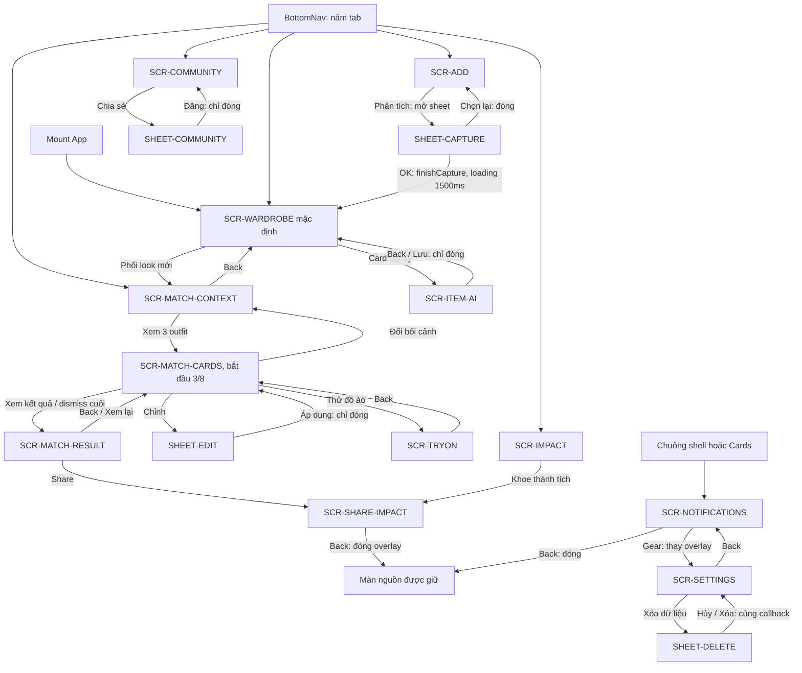

Các transition lấy từ dispatcher `src/App.tsx:553–588`; action trên component tại `src/App.tsx:156–161`, `src/App.tsx:198–207`, `src/App.tsx:220–261`, `src/App.tsx:360–367`, `src/App.tsx:397–423`, `src/App.tsx:442–542`.

**Quy tắc chung:** `changeTab` đóng cả overlay và CaptureSheet, đổi tab; nếu tab đích là Match thì reset stage về Context, kể cả bấm lại tab Match đang active (`src/App.tsx:553–558`). BottomNav vẫn có thể tương tác trong overlay theo CSS: nav `z-index:100`, overlay `50`, sheet chừa đáy 78px (`src/index.css:5`, `src/index.css:12–18`).

## 5. Phase 2 — Điều tra từng màn hình

### 5.1. SCR-ADD — Thêm ảnh + SHEET-CAPTURE

**Entry/state:** chọn Thêm mount `AddUpload`, khởi tạo `photos=[]`, `agreed=false`; parent giữ boolean sheet. Mở sheet không unmount AddUpload (`src/App.tsx:171–172`, `src/App.tsx:548`, `src/App.tsx:573`, `src/App.tsx:580`).

| UI → action | Event handler → state | API → UI result / điểm kết thúc | Status |
|---|---|---|---|
| Chạm vùng upload | `setPhotos([0,1,2])` | Không API; hiện ba SVG và số ảnh, không mở file picker | MOCKED (`src/App.tsx:166–190`) |
| Chạm thumbnail / X | `stopPropagation`; `removePhoto(i)` lọc ID | Xóa mục khỏi lựa chọn, không vô tình thêm lại ảnh | IMPLEMENTED (`src/App.tsx:173`, `src/App.tsx:186–188`) |
| Đồng ý xử lý | `setAgreed(checked)` | Đổi checkbox; CTA chỉ enable khi có ảnh và đồng ý | IMPLEMENTED UI (`src/App.tsx:195–198`) |
| Phân tích với AI | `onAnalyze` → `setCaptureSheet(true)` | Mở sheet, không chạy phân tích | IMPLEMENTED mở; MOCKED nghiệp vụ (`src/App.tsx:198`, `src/App.tsx:573`) |
| Checkbox outfit/pose/nền | Input uncontrolled, mặc định chỉ outfit | Chỉ đổi DOM; không state/payload truyền tiếp; OK vẫn bật khi bỏ cả ba | PARTIAL (`src/App.tsx:202–207`) |
| Chọn lại ảnh | `onRetake` → sheet=false | Quay về Add, giữ ảnh/consent, không mở picker | PARTIAL theo nhãn (`src/App.tsx:207`, `src/App.tsx:580`) |
| OK | `finishCapture` → sheet=false; tab=wardrobe; new=true; loading=true | Hiện ba món mock; 1500ms sau loading=false | MOCKED lưu/phân tích (`src/App.tsx:559–564`, `src/App.tsx:580`) |

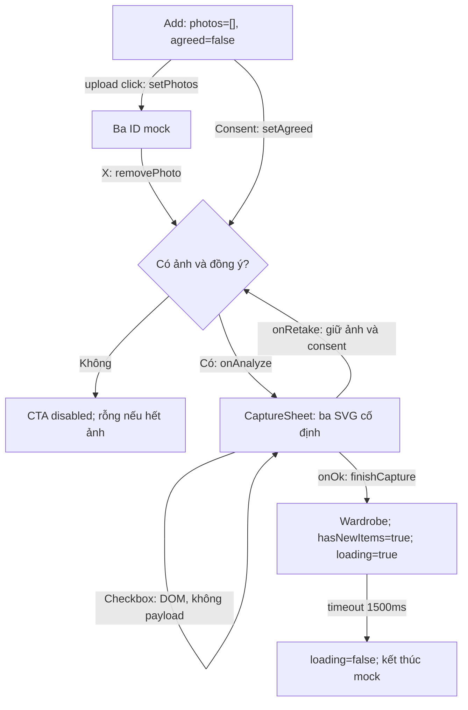

Nguồn sơ đồ: `src/App.tsx:165–209`, `src/App.tsx:559–564`, `src/App.tsx:573`, `src/App.tsx:580`.

**Loading/error/empty:** empty chọn ảnh có thật, xóa hết disable CTA; kiểm tra JPG/PNG/10 ảnh chỉ là text. Loading chỉ bắt đầu ở Tủ đồ sau OK; không có phân tích đang chạy, lỗi, retry hay kiểm tra file thật trong component/handler đã đọc (`src/App.tsx:178–198`, `src/App.tsx:202–209`, `src/App.tsx:559–564`).

**Persistence/end:** rời tab unmount Add, mất ảnh/consent; đóng sheet giữ chúng. Sheet remount reset checkbox về mặc định. Bộ ảnh đã xóa không truyền sang sheet nên vẫn hiện đủ ba thumbnail (`src/App.tsx:165`, `src/App.tsx:171–172`, `src/App.tsx:202–206`, `src/App.tsx:573`, `src/App.tsx:580`).

**Gaps:** riêng tư EXIF/GPS/làm mờ là text, không có xử lý ảnh trong chuỗi này; upload dùng `div onClick` thiếu keyboard handling; nút X không có accessible name và chỉ 23px (`src/App.tsx:57`, `src/App.tsx:178–198`, `src/index.css:49`).

### 5.2. SCR-WARDROBE — Tủ đồ

**Entry/state:** màn mặc định; còn được mở từ capture OK, BottomNav hoặc Back Context. Filter cục bộ mặc định “Tất cả”; `hasNewItems/loading` ở App (`src/App.tsx:143`, `src/App.tsx:546–550`, `src/App.tsx:559–575`).

| UI → action | Event handler → state | API → UI result / end | Status |
|---|---|---|---|
| Chip loại đồ | `setFilter(f)` | Chỉ đổi class selected; `visibleItems` không dùng filter | PARTIAL (`src/App.tsx:143–156`) |
| Card bất kỳ | `onItem()` → overlay=item | Mở cùng ItemDetail, không truyền món/index | PARTIAL (`src/App.tsx:142`, `src/App.tsx:156`, `src/App.tsx:574`, `src/App.tsx:581`) |
| Phối look mới | `setTab(match)`; `setMatchStage(context)` | Mở Context, không truyền selected item | IMPLEMENTED navigation (`src/App.tsx:161`, `src/App.tsx:574–575`) |
| Capture incoming | `hasNewItems=true`, `loading=true` | Ghép ba món mock trước 12 món; sau 1500ms tắt loading | MOCKED (`src/App.tsx:145–153`, `src/App.tsx:559–564`) |
| Chuông / BottomNav | `setOverlay(notifications)` / `changeTab` | Mở thông báo hoặc rời màn | IMPLEMENTED (`src/App.tsx:571`, `src/App.tsx:579`) |

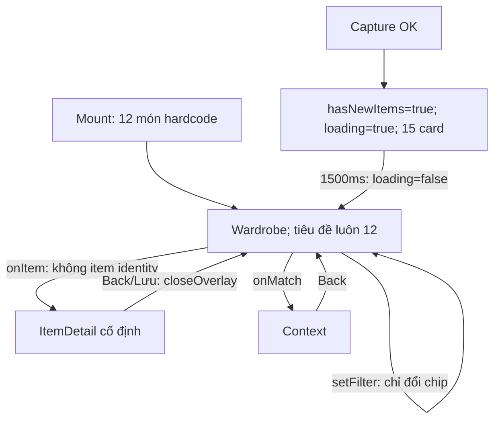

Nguồn sơ đồ: `src/App.tsx:121–163`, `src/App.tsx:559–565`, `src/App.tsx:574–575`, `src/App.tsx:581`.

**Loading:** banner/spinner và class skeleton trên ba card đầu, card vẫn có thể bấm. CSS skeleton chỉ nhắm `.garment,.item-copy`, nhưng ảnh hiện dùng `.product-photo/.product-placeholder`, nên ảnh/placeholder không nhận hiệu ứng làm mờ đó (`src/App.tsx:136–139`, `src/App.tsx:153–158`, `src/index.css:5`, `src/index.css:98–100`).

**Empty/error:** có placeholder cho `image=''`, không có `onError` cho URL hỏng; không có empty tủ đồ, lỗi tải/lưu hoặc retry trong Wardrobe/finishCapture (`src/App.tsx:121–163`, `src/App.tsx:559–565`). Avatar Y và nhãn ít mặc không có action trong markup (`src/App.tsx:152–159`).

**Persistence/gaps:** overlay giữ filter; rời tab reset filter do remount. Boolean món mới sống cùng App nhưng không lưu bền; capture lặp không tăng thêm batch, chỉ giữ 15 card. Tiêu đề 12 không đổi; timer capture không có hủy/ID nên lượt trước có thể tắt loading lượt sau nếu chồng thời gian (`src/App.tsx:143–152`, `src/App.tsx:545–565`, `src/App.tsx:573–581`).

### 5.3. SCR-MATCH-CONTEXT — Thu thập ngữ cảnh

**Entry:** tab Gu Match, Phối look mới, hoặc Đổi bối cảnh từ Cards; tất cả hội tụ ở `matchStage=context` (`src/App.tsx:553–558`, `src/App.tsx:574–575`).

| UI → action | Handler → state | API → UI result / end | Status |
|---|---|---|---|
| Back | `setTab(wardrobe)` | Luôn về Tủ đồ, kể cả vừa đến từ Cards | IMPLEMENTED (`src/App.tsx:220`, `src/App.tsx:575`) |
| Đọc các thẻ ngữ cảnh | Không action; literal JSX | Lịch Tokyo, thời tiết 16–19°C, mưa 80%, tàu/đi bộ, phong cách cố định | MOCKED (`src/App.tsx:212–255`) |
| Sparkle header | Không `onClick` | Không phản hồi | NOT_FOUND handler (`src/App.tsx:222`) |
| Xem 3 outfit | `setMatchStage(cards)` | Mở Cards ngay, khởi tạo 3/8; không truyền dữ liệu thu thập | PARTIAL (`src/App.tsx:260–261`, `src/App.tsx:291`, `src/App.tsx:361`, `src/App.tsx:575`) |
| Chỉnh/chọn bối cảnh | Không control/setter call | `matchContext` vẫn “Đi làm” | NOT_FOUND (`src/App.tsx:211–265`, `src/App.tsx:552–590`) |

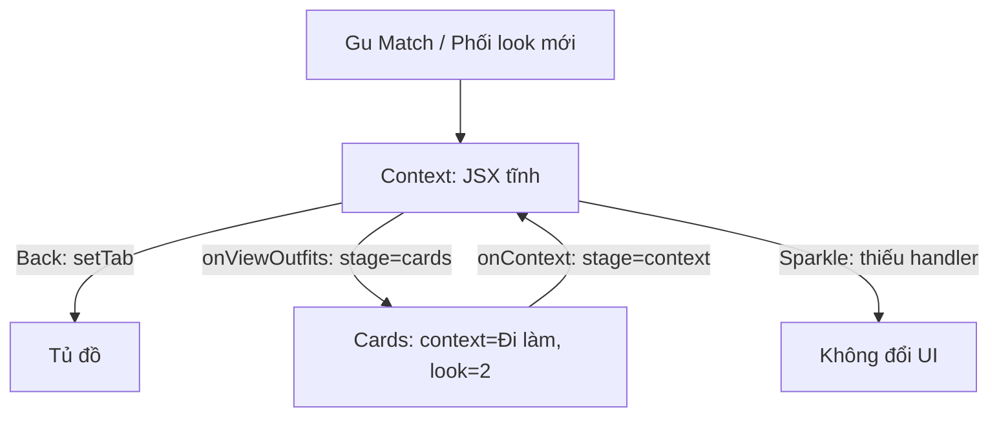

Nguồn sơ đồ: `src/App.tsx:211–265`, `src/App.tsx:291`, `src/App.tsx:552–575`.

**Loading/error/empty:** câu “đang thu thập”, tiêu đề “đã phân tích” và “đã sẵn sàng” xuất hiện đồng thời; không có state tiến trình, lỗi quyền, lịch rỗng, retry hoặc điều kiện disable CTA trong component (`src/App.tsx:217–263`). Không có request/quyền thiết bị trong chuỗi Context và callbacks (`src/App.tsx:211–265`, `src/App.tsx:553–575`).

**Persistence/gaps:** component không có state ngữ cảnh; App khởi tạo “Đi làm” và không gọi `setMatchContext` trong toàn file. Năm nhóm ảnh tồn tại nhưng không có UI chọn; thời tiết Context 16–19°C lệch literal 29° ở shell/Cards. Copy dựa trên “tủ đồ hiện có” nhưng props chỉ gồm hai callback (`src/App.tsx:73`, `src/App.tsx:211`, `src/App.tsx:239`, `src/App.tsx:260–288`, `src/App.tsx:360`, `src/App.tsx:552`, phạm vi setter `src/App.tsx:1–590`).

### 5.4. SCR-MATCH-CARDS — Quẹt outfit + SHEET-EDIT

**Entry/state:** mỗi mount đặt `look=2`, toast/drag/transition/animation mặc định; không nhận state selected outfit từ App. Hai thẻ current/next là cùng screen (`src/App.tsx:290–299`, `src/App.tsx:355–358`, `src/App.tsx:575`).

| UI → action | Handler → state | API → UI result / end | Status |
|---|---|---|---|
| Pointer down/move | Bỏ qua khi animation/target button; lưu điểm bắt đầu, capture pointer; cập nhật `dragX` | Thẻ dịch ngang và xoay, thẻ kế trượt theo | IMPLEMENTED (`src/App.tsx:298–299`, `src/App.tsx:320–330`, `src/App.tsx:346–348`) |
| Up/cancel dưới 70px | `finishDrag`: dragX=0, transition=true; 260ms tắt | Trả thẻ; cancel dùng chung handler với up | IMPLEMENTED; cancel PARTIAL (`src/App.tsx:333–356`) |
| Up/cancel từ 70px | `dismiss(distance>0)` | Phải=thích, trái=bỏ; không có nhánh cancel riêng | IMPLEMENTED hành vi hiện tại (`src/App.tsx:337`, `src/App.tsx:356`) |
| Bỏ/Thích | `dismiss(false/true)` guard animating; drag ±480; timer 320ms | Tăng look; ở index 7 gọi onFinish dù thích hay bỏ. Thích bật toast 900ms, không lưu look ID | IMPLEMENTED quẹt; MOCKED lưu (`src/App.tsx:301–318`, `src/App.tsx:362–365`) |
| Đổi bối cảnh / Xem kết quả | stage=context / result | Rời Cards; không payload/selection | PARTIAL nghiệp vụ (`src/App.tsx:361`, `src/App.tsx:575`) |
| Chỉnh / Thử đồ ảo / Chuông | overlay=edit / tryon / notifications | Mở overlay, Cards vẫn mounted | IMPLEMENTED navigation (`src/App.tsx:366–367`, `src/App.tsx:360`, `src/App.tsx:575`, `src/App.tsx:582–586`) |
| Edit: Trước/Sau | `setAfter(false/true)` | Đổi mannequin 0/1, điểm 82/89; không tính điểm thật | MOCKED (`src/App.tsx:489–492`) |
| Edit: loại đồ / chọn món | Loại không handler; mọi món `setAfter(true)` | Luôn đánh dấu món thứ hai khi after, không giữ identity món bấm | PARTIAL (`src/App.tsx:493–494`) |
| Edit: Áp dụng | `onClose` → overlay=none | Không cập nhật outfit/score trên Cards hoặc Result | PARTIAL; mutation NOT_FOUND (`src/App.tsx:495`, `src/App.tsx:566`, `src/App.tsx:582`) |

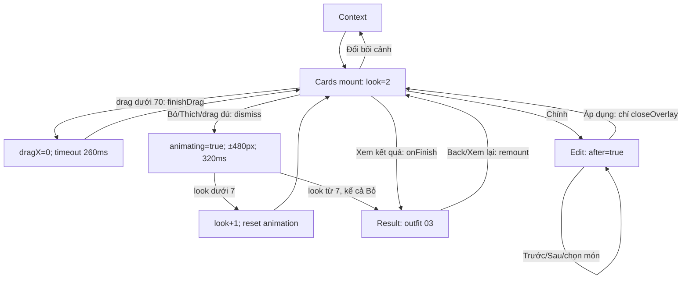

Nguồn sơ đồ: `src/App.tsx:291–344`, `src/App.tsx:361–367`, `src/App.tsx:488–495`, `src/App.tsx:575`, `src/App.tsx:582`.

**Điểm kết thúc:** tối đa sáu quyết định từ index 2 đến 7; không quẹt vô hạn. Modulo chỉ dùng cho thẻ preview kế. Result luôn index 2; các đường kết thúc không giữ outfit được thích hay outfit cuối (`src/App.tsx:291`, `src/App.tsx:311–317`, `src/App.tsx:357`, `src/App.tsx:418–419`, `src/App.tsx:575`).

**Loading/error/empty:** không có request sinh outfit, loading nghiệp vụ, empty deck, lỗi ảnh/retry trong MatchCards/EditLook; ảnh Unsplash không có load/error handler. Tên look, điểm 82% và lời nhắc 41 ngày cố định cho mọi ảnh (`src/App.tsx:290–370`, `src/App.tsx:488–497`, đặc biệt `src/App.tsx:350–352`).

**Persistence/timer/gaps:** overlay giữ look; đổi stage/tab remount reset look về 2. Edit mở lại reset `after=true`. Timer 260/320/900ms không cleanup, timer toast trước không bị hủy; timer dismiss tại look 7 vẫn có thể gọi onFinish sau khi đã rời screen. CSS transition 320ms nhưng snap-back bỏ class sau 260ms; pointer cancel vượt ngưỡng vẫn quyết định thích/bỏ (`src/App.tsx:301–344`, `src/App.tsx:489`, `src/App.tsx:575`, `src/index.css:70`).

### 5.5. SCR-MATCH-RESULT — Tác động & outfit đã chọn

**Entry:** “Xem kết quả” hoặc dismiss card cuối cùng gọi cùng callback, không kiểm tra có lựa chọn hợp lệ. Chỉ nhận `context` và callback, không selected look (`src/App.tsx:301–318`, `src/App.tsx:361`, `src/App.tsx:372`, `src/App.tsx:575`).

| UI → action | Handler → state | API → UI result / end | Status |
|---|---|---|---|
| Đọc kết quả | Metrics/items literal, ảnh `outfitPhotos[context][2]` | Top 8%, 6kg, 3 tháng; outfit 03 và năm món cố định | MOCKED (`src/App.tsx:376–387`, `src/App.tsx:417–420`) |
| Info | `setShowInfo(v=>!v)` | Hiện/ẩn ghi chú chỉ số demo | IMPLEMENTED (`src/App.tsx:375`, `src/App.tsx:408–409`) |
| Lưu vào lịch | Guard saved; saved=true; toast=true; timeout 2400ms | Đổi nhãn, disable nút, toast; không tạo bản ghi lịch | MOCKED nghiệp vụ (`src/App.tsx:388–392`, `src/App.tsx:423`, `src/App.tsx:427`) |
| Back / Xem lại outfit | `setMatchStage(cards)` | Remount Cards ở look=2, không khôi phục deck cũ | IMPLEMENTED chuyển; PARTIAL review (`src/App.tsx:291`, `src/App.tsx:397`, `src/App.tsx:422`, `src/App.tsx:575`) |
| Share | overlay=shareImpact | Mở story chung, không truyền metrics/outfit | PARTIAL (`src/App.tsx:399`, `src/App.tsx:575`, `src/App.tsx:584`) |

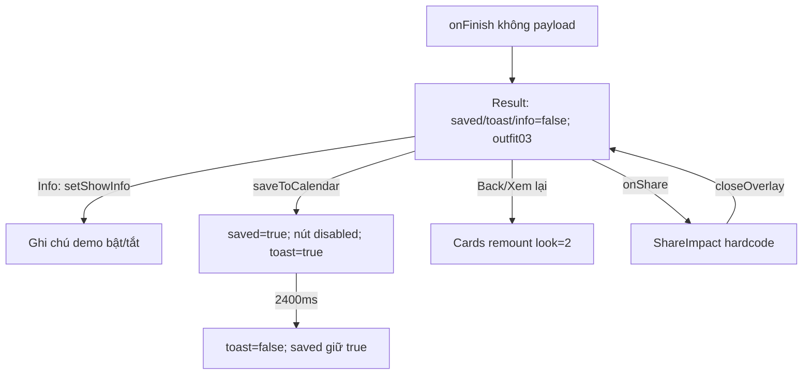

Nguồn sơ đồ: `src/App.tsx:372–429`, `src/App.tsx:511–518`, `src/App.tsx:575`, `src/App.tsx:584`.

**Loading/error/empty:** không có trong component; ảnh rừng và outfit không có fallback khi lỗi; không có nhánh chưa chọn outfit dù có thể tới đây bằng Bỏ hết hoặc xem ngay (`src/App.tsx:301–318`, `src/App.tsx:361`, `src/App.tsx:372–429`).

**Persistence/gaps:** share giữ Result mounted và state; đổi stage/tab mất saved/info. Timer 2400ms không cleanup. “Đã lưu vào lịch” không tồn tại khi remount, dashboard không nhận cập nhật. Share hiển thị 24 look/68%, không metrics của Result (`src/App.tsx:373–392`, `src/App.tsx:514`, `src/App.tsx:575–584`). Nút info truyền `aria-label` nhưng `Button` không forward, SVG aria-hidden nên nhãn không đến DOM (`src/App.tsx:57`, `src/App.tsx:64–65`, `src/App.tsx:408`).

### 5.6. SCR-IMPACT — Dashboard Tác động

**Phân biệt:** đây là tab `Impact`, không phải `ImpactResult` sau Cards; hai nhánh render riêng (`src/App.tsx:431`, `src/App.tsx:575–576`).

| UI → action | Handler → state | API → UI result / end | Status |
|---|---|---|---|
| Vào tab Tác động | `changeTab(impact)` | Render ngay, không tải số liệu | IMPLEMENTED navigation (`src/App.tsx:553–558`, `src/App.tsx:576`, `src/App.tsx:579`) |
| Metrics/chart/level/streak/badge/mission | Literal JSX; chart `[48,69,57,90]` | 24 look, 68%, -2.1, cấp 3, 340/500, streak 5, nhiệm vụ 1/3 cố định; không handler drill-down | MOCKED (`src/App.tsx:434–441`) |
| Khoe thành tích | `onShare` → overlay=shareImpact | Story preview chung | IMPLEMENTED mở (`src/App.tsx:442`, `src/App.tsx:576`, `src/App.tsx:584`) |
| Chuông / nav | Setter overlay / `changeTab` | Thông báo hoặc tab khác | IMPLEMENTED (`src/App.tsx:571`, `src/App.tsx:579`) |

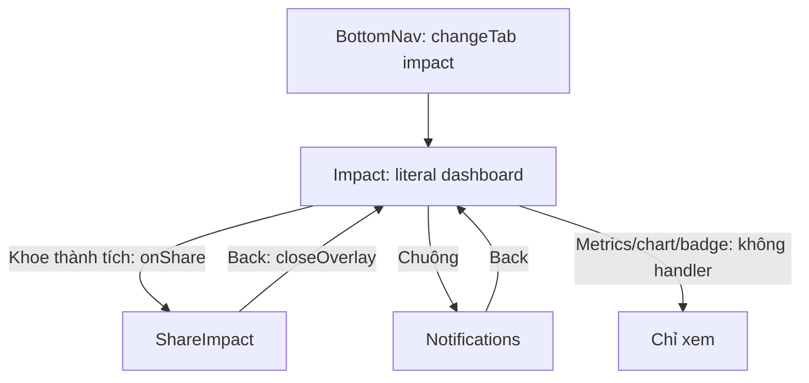

Nguồn sơ đồ: `src/App.tsx:431–444`, `src/App.tsx:553–588`.

**Loading/error/empty/persistence:** component không có state hoặc nhánh loading/error/empty/retry, không nguồn tính lại. Capture chỉ thay state Tủ đồ; like chỉ state Cards; lưu lịch chỉ state Result; `Impact` chỉ nhận onShare nên không có đường cập nhật theo hoạt động (`src/App.tsx:301–318`, `src/App.tsx:388–392`, `src/App.tsx:431–443`, `src/App.tsx:559–576`).

**Gaps:** không diễn giải đơn vị -2.1, số trên cột hay drill-down; vòng 75% và progress 68% cố định trong CSS. “Kỳ vọng, đo ở pilot” là chú thích hiện có, không bằng chứng tính toán. Story lặp số liệu bằng literal riêng (`src/App.tsx:434–438`, `src/App.tsx:514`, `src/index.css:5`).

### 5.7. SCR-COMMUNITY — Cộng đồng + SHEET-COMMUNITY

**Entry/state:** tab Community render bốn card hardcode; mở sheet khởi tạo `kind=Lookbook của tôi`, `visibility=Chỉ mình tôi` (`src/App.tsx:451–456`, `src/App.tsx:521–522`, `src/App.tsx:577`, `src/App.tsx:585`).

| UI → action | Handler → state | API → UI result / end | Status |
|---|---|---|---|
| Chip feed | Không handler; chip đầu selected theo index | Không đổi feed | PARTIAL UI; filter NOT_FOUND (`src/App.tsx:459`) |
| Card/avatar/tim/bookmark | Div/span/SVG không handler | Không mở bài/hồ sơ/thích/lưu; số thích `42+i*9` | MOCKED feed; action NOT_FOUND (`src/App.tsx:460–465`) |
| Chia sẻ | overlay=shareCommunity | Mở sheet | IMPLEMENTED (`src/App.tsx:466`, `src/App.tsx:577`, `src/App.tsx:585`) |
| Chọn loại bài | `setKind(x)` | Preview SVG/24 look hoặc textarea | IMPLEMENTED lựa chọn; MOCKED preview (`src/App.tsx:524–525`) |
| Nhập Cảm nghĩ | Textarea uncontrolled, không state nội dung | Chỉ giữ trong DOM; đổi loại làm unmount và mất chữ | PARTIAL (`src/App.tsx:525`) |
| Chọn hiển thị | `setVisibility` | Chỉ đổi active; không payload/quyền thực thi | PARTIAL (`src/App.tsx:526–527`) |
| Đăng | `onClose` → overlay=none | Đóng sheet; feed vẫn bốn card; không đọc nội dung/kind/visibility | PARTIAL UI; posting NOT_FOUND (`src/App.tsx:527`, `src/App.tsx:566`, `src/App.tsx:585`) |

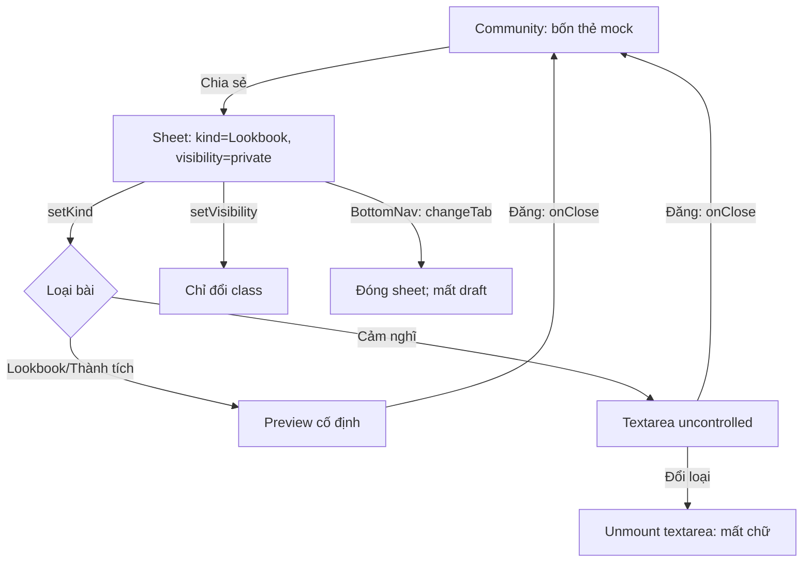

Nguồn sơ đồ: `src/App.tsx:450–468`, `src/App.tsx:520–529`, `src/App.tsx:553–558`, `src/App.tsx:585`.

**Loading/error/empty:** không có load feed, pagination, retry, empty feed hoặc validation nội dung trong hai component; “Đăng” luôn bật kể cả cảm nghĩ rỗng (`src/App.tsx:450–468`, `src/App.tsx:520–529`).

**Persistence/end/gaps:** đổi visibility giữ textarea vì cùng nhánh, nhưng đổi kind rồi quay lại mất chữ. Đóng/mở sheet reset lựa chọn; đổi tab đóng sheet không xác nhận draft. Không nút Hủy/X/backdrop/Escape handler trong sheet, chỉ nav là lối thoát có wiring; text “không có gì được đăng…” chưa có action đăng tương ứng (`src/App.tsx:523–528`, `src/App.tsx:553–558`, `src/App.tsx:585`; lớp nav `src/index.css:12–18`).

### 5.8. SCR-ITEM-AI — AI đọc ảnh

**Entry/identity:** tất cả card gọi callback không tham số; parent không giữ selected item, `ItemDetail` chỉ nhận onClose. Nội dung không phụ thuộc card đã chọn (`src/App.tsx:142`, `src/App.tsx:156`, `src/App.tsx:470`, `src/App.tsx:545–552`, `src/App.tsx:574`, `src/App.tsx:581`).

| UI → action | Handler → state | API → UI result / end | Status |
|---|---|---|---|
| Xem nhận diện | Ba SVG, confidence 94/91/88 literal | Luôn áo/quần/giày, không ảnh nguồn thật | MOCKED (`src/App.tsx:477–482`) |
| Loại/màu/chất liệu/phong cách | `updateTag(index)` đảo hai giá trị | Đổi tags cục bộ; tiêu đề/hình/confidence vẫn cũ | PARTIAL (`src/App.tsx:471–479`) |
| Chevron món 2/3 | Div không handler | Không mở chi tiết từng món | NOT_FOUND (`src/App.tsx:481–482`) |
| Lưu 3 món / Back | Cùng `onClose` → closeOverlay | Trở về Wardrobe, không mutation | MOCKED lưu; IMPLEMENTED đóng (`src/App.tsx:475`, `src/App.tsx:484`, `src/App.tsx:566`, `src/App.tsx:581`) |
| Chuông header | Không truyền onBell | Nút hiển thị nhưng không mở Notifications | PARTIAL (`src/App.tsx:68–75`, `src/App.tsx:475`) |

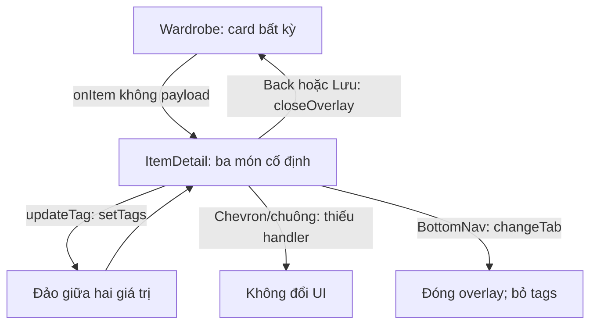

Nguồn sơ đồ: `src/App.tsx:156`, `src/App.tsx:470–485`, `src/App.tsx:553–588`.

**Loading/error/empty/persistence:** không có nhánh phân tích/lưu/loading/error/empty/retry trong component. Tags reset sau đóng hoặc đổi tab vì unmount; không lưu vào collection. Capture không đi qua màn này nên “kiểm tra và sửa trước khi lưu” không nằm trong đường thêm ảnh thực tế (`src/App.tsx:470–485`, `src/App.tsx:559–564`, `src/App.tsx:580–581`). Các cặp tag: Áo sơ mi/Áo khoác, Violet/Tím đậm, Cotton/Linen, Street/Tối giản; không có picker/nhập tự do (`src/App.tsx:471–473`).

### 5.9. SCR-TRYON — Thử đồ ảo

**Entry/state:** Cards → overlay tryon; props chỉ onClose, không outfit/context. Mặc định `mine=false`, `consented=false`, kết quả hiện ngay (`src/App.tsx:367`, `src/App.tsx:499–506`, `src/App.tsx:575`, `src/App.tsx:583`).

| UI → action | Handler → state | API → UI result / end | Status |
|---|---|---|---|
| Dùng mô hình ảo | `setMine(false)` | Hiện SVG và critic ngay | IMPLEMENTED lựa chọn; MOCKED kết quả (`src/App.tsx:504–506`) |
| Dùng ảnh của tôi | `setMine(true)` | Nếu chưa consent thì hiện xác nhận; không chọn/upload ảnh | PARTIAL (`src/App.tsx:504–505`) |
| Đồng ý | `setConsented(checked)` | Checkbox biến mất, cùng mannequin look=1 hiện lại | IMPLEMENTED UI; MOCKED xử lý ảnh (`src/App.tsx:505–506`) |
| Critic/Auto re-render/câu hỏi giữ hay render lại | Text, div, danh sách cố định | Không button/handler render lại hay vòng kiểm tra | MOCKED; action NOT_FOUND (`src/App.tsx:506`) |
| Back / chuông / nav | closeOverlay / thiếu onBell / changeTab | Back về Cards; chuông không tác dụng; nav đóng overlay | IMPLEMENTED Back/nav; PARTIAL chuông (`src/App.tsx:502`, `src/App.tsx:68–75`, `src/App.tsx:553–558`, `src/App.tsx:566`) |

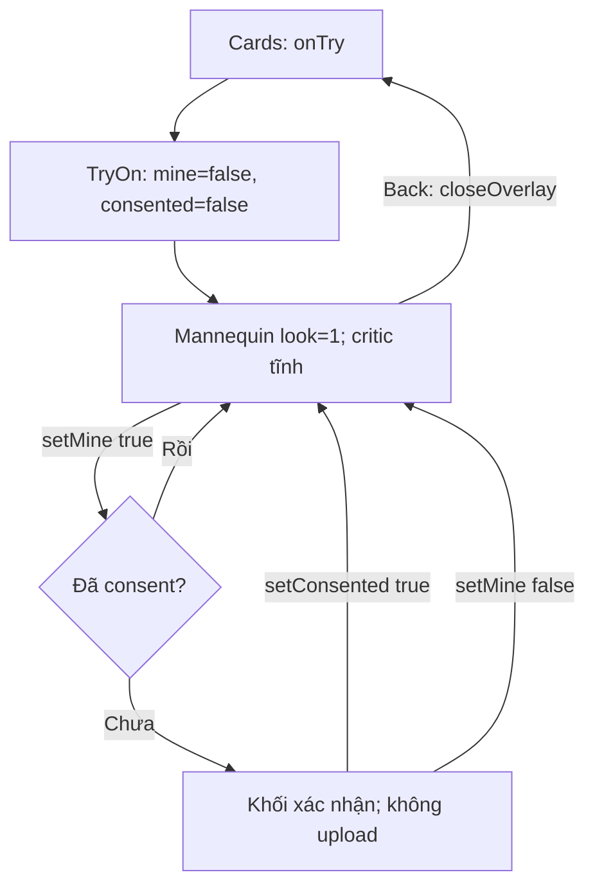

Nguồn sơ đồ: `src/App.tsx:499–509`, `src/App.tsx:575`, `src/App.tsx:583`.

**Loading/error/empty/persistence:** không tác vụ sinh ảnh, loading, error, retry hoặc empty; kết quả luôn SVG `look=1`. Đổi mô hình không reset consent; quay lại ảnh cá nhân sau đồng ý vào thẳng kết quả, không còn checkbox rút lại trên view đó. Đóng/mở overlay mới reset cả hai state (`src/App.tsx:500–506`, `src/App.tsx:583`).

**Gaps:** text xóa EXIF/GPS không có pipeline xử lý tương ứng. “Cmax=5”, “Không méo cơ thể / Auto re-render” không gắn counter hay render; câu hỏi về tay áo không có đường trả lời. Outfit trên Cards không được truyền vào (`src/App.tsx:499–506`, `src/App.tsx:575`, `src/App.tsx:583`).

### 5.10. SCR-SHARE-IMPACT — Khoe thành tích

**Hai entry:** Dashboard CTA và icon Share của Result đặt cùng overlay. `ShareImpact` chỉ nhận onClose, không origin, metrics hay outfit (`src/App.tsx:399`, `src/App.tsx:442`, `src/App.tsx:511`, `src/App.tsx:575–576`, `src/App.tsx:584`).

| UI → action | Handler → state | API → UI result / end | Status |
|---|---|---|---|
| Xem story | Literal cấp 3, 24 look, 68%, hai badge | Cùng story cho hai entry; không dùng metrics Result | MOCKED (`src/App.tsx:514`) |
| Hiện outfit yêu thích | `setShow(checked)`, mặc định false | Thêm/ẩn mannequin look=1, không selected favorite | IMPLEMENTED toggle; MOCKED favorite (`src/App.tsx:512–515`) |
| Lưu ảnh / Chia sẻ / Sao chép liên kết | Không truyền onClick | Không xuất file/native share/clipboard/link/toast | PARTIAL UI; handler NOT_FOUND (`src/App.tsx:64–65`, `src/App.tsx:516`) |
| Back / chuông | onClose / không onBell | Đóng về màn nguồn / không phản hồi | IMPLEMENTED Back; PARTIAL chuông (`src/App.tsx:68–75`, `src/App.tsx:513`, `src/App.tsx:566`) |

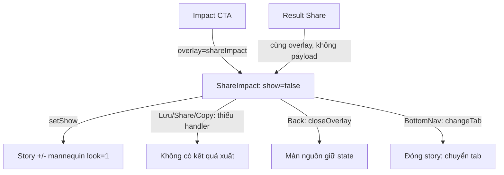

Nguồn sơ đồ: `src/App.tsx:511–518`, `src/App.tsx:553–588`.

**Loading/error/empty/persistence:** chỉ state show; không nhánh loading/error/empty/retry/kết quả chia sẻ. Mở lại reset show=false, mở overlay giữ màn nguồn mounted. Toggle dùng input `display:none`, không vào Tab order; story không lưu bền (`src/App.tsx:511–518`, `src/App.tsx:575–584`, `src/index.css:5`).

**Gap dữ liệu:** Result hiển thị Top8/6kg/3 tháng nhưng share thành 24 look/68%; checkbox “yêu thích” không liên hệ lượt thích thực (`src/App.tsx:376–380`, `src/App.tsx:514–516`).

### 5.11. SCR-NOTIFICATIONS — Thông báo

**Entry:** chuông shell ở Add/Wardrobe/Impact/Community và chuông Cards có wiring. Context/Result không có chuông. Header trong ItemDetail/TryOn/ShareImpact/Settings vẫn vẽ chuông nhưng không được truyền onBell (`src/App.tsx:68–75`, `src/App.tsx:219–223`, `src/App.tsx:360`, `src/App.tsx:396–400`, `src/App.tsx:475`, `src/App.tsx:502`, `src/App.tsx:513`, `src/App.tsx:537`, `src/App.tsx:567–575`).

| UI → action | Handler → state | API → UI result / end | Status |
|---|---|---|---|
| Mở thông báo | overlay=notifications | Render bốn dòng cố định theo Hôm nay/Trước đó | IMPLEMENTED mở; MOCKED dữ liệu (`src/App.tsx:531–534`, `src/App.tsx:571`, `src/App.tsx:575`, `src/App.tsx:586`) |
| Chạm dòng | Div không handler | Không đi bài/look/nhiệm vụ; không mark-read | NOT_FOUND (`src/App.tsx:533`) |
| Dấu chưa đọc | `i===0` ở dòng đầu; chuông luôn có i | Xem rồi không xóa dấu; không read-state | MOCKED (`src/App.tsx:75`, `src/App.tsx:360`, `src/App.tsx:533`) |
| Back | closeOverlay → none | Lộ màn nền được giữ | IMPLEMENTED (`src/App.tsx:566`, `src/App.tsx:586`) |
| Bánh răng | overlay=settings | Thay Notifications bằng Settings | IMPLEMENTED (`src/App.tsx:586–587`) |

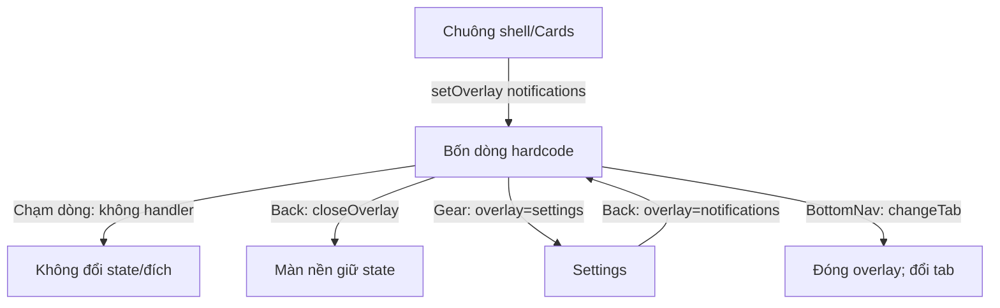

Nguồn sơ đồ: `src/App.tsx:531–538`, `src/App.tsx:553–588`.

**Loading/error/empty/persistence:** không state/effect riêng; thời gian “2 phút/1 giờ/3 giờ/Hôm qua” không tính lại, không API, load/error/empty/retry/mark-all trong component. Overlay enum thay thế nên Gear unmount Notifications, Back dựng lại danh sách; không có code lưu cuộn/read-state (`src/App.tsx:531–534`, `src/App.tsx:547`, `src/App.tsx:586–588`).

**End/gaps:** điều hướng tới Settings hoàn chỉnh nhưng các đích nội dung thông báo bị đứt; chấm chuông và chấm dòng không phản ánh đã xem. Màn nền không unmount chỉ vì mở overlay, nên filter/look giữ nguyên nếu không đổi tab/stage (`src/App.tsx:143`, `src/App.tsx:291`, `src/App.tsx:572–588`).

### 5.12. SCR-SETTINGS — Cài đặt + SHEET-DELETE

**Entry:** Gear Notifications; back Settings luôn về Notifications. Settings và DeleteSheet thay nhau theo enum; khi mở Delete, Settings không còn ở nền (`src/App.tsx:547`, `src/App.tsx:586–588`).

| UI → action | Handler → state | API → UI result / end | Status |
|---|---|---|---|
| Chia sẻ lookbook / Thông báo | Button không onClick | “Chỉ mình tôi” / “Đang bật” cố định, không mở/toggle | PARTIAL UI; setting action NOT_FOUND (`src/App.tsx:537`) |
| Xóa dữ liệu của tôi | onDelete → overlay=delete | Mount sheet, typed='' | IMPLEMENTED mở (`src/App.tsx:537`, `src/App.tsx:541`, `src/App.tsx:587–588`) |
| Nhập xác nhận | `setTyped(value)`; disabled khi `typed !== 'XÓA'` | Chỉ chuỗi chính xác enable nút; không trim/normalize | IMPLEMENTED validation UI (`src/App.tsx:541–542`) |
| Hủy / Xóa vĩnh viễn | Cùng onClose → overlay=settings | Cùng kết quả; không reset collection/state hoặc gọi xóa | IMPLEMENTED đóng; MOCKED xóa (`src/App.tsx:542`, `src/App.tsx:588`) |
| Back Settings / chuông | overlay=notifications / onBell undefined | Quay về thông báo / không phản hồi | IMPLEMENTED Back; PARTIAL chuông (`src/App.tsx:68–75`, `src/App.tsx:537`, `src/App.tsx:587`) |

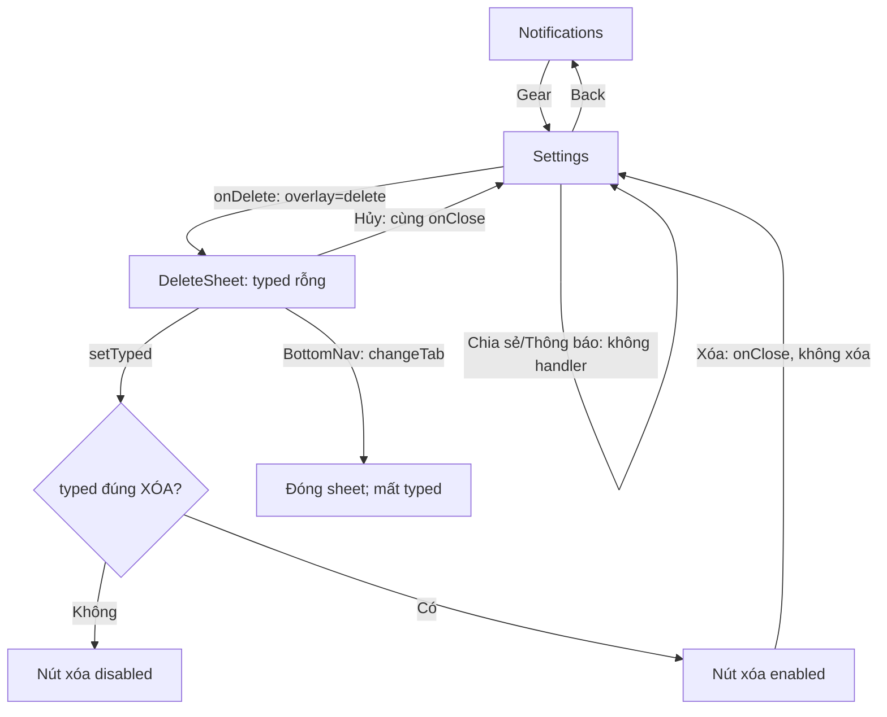

Nguồn sơ đồ: `src/App.tsx:536–543`, `src/App.tsx:553–558`, `src/App.tsx:586–588`.

**Loading/error/empty:** không đang xóa, thất bại/retry, thành công hay tủ rỗng sau xóa trong component/handler. Cảnh báo không hoàn tác chưa nối tới thao tác dữ liệu (`src/App.tsx:536–543`, `src/App.tsx:588`).

**Persistence/end/gaps:** mở lại reset typed vì remount. `XÓA` enable; `xóa`, `XOA` hoặc có khoảng trắng không enable theo phép so sánh chính xác. `hasNewItems` không bị reset khi xác nhận; thêm ba món trước đó vẫn còn khi quay lại Tủ đồ. Danh sách “12 món” ở sheet luôn literal, kể cả Tủ đồ đã 15 (`src/App.tsx:145–150`, `src/App.tsx:541–542`, `src/App.tsx:550`, `src/App.tsx:559–564`, `src/App.tsx:574`, `src/App.tsx:588`).

## 6. Phase 3 — Đối soát transition và dữ liệu xuyên màn hình

### 6.1. Các transition có UI nhưng đứt payload/kết quả

| Transition | Dữ liệu/điều kiện AS-IS | Kết luận | Bằng chứng |
|---|---|---|---|
| Add → CaptureSheet | Callback không tham số; sheet tự dựng ba SVG | Không giữ tập ảnh đã chọn, kể cả đã xóa bớt | `src/App.tsx:165`, `src/App.tsx:202–207`, `src/App.tsx:573`, `src/App.tsx:580` |
| CaptureSheet → Wardrobe | OK không nhận checkbox; `hasNewItems=true` | Ba lựa chọn phân tích không ảnh hưởng kết quả; batch không tích lũy | `src/App.tsx:206–207`, `src/App.tsx:145–150`, `src/App.tsx:559–564` |
| CaptureSheet → ItemDetail | Không có cạnh render này | Review trước khi lưu không nằm trong capture path | `src/App.tsx:559–564`, `src/App.tsx:580–581` |
| Wardrobe → ItemDetail | `onItem:()=>void`, không selected item | Mọi card mở cùng ba món; không phải detail đúng item | `src/App.tsx:142`, `src/App.tsx:156`, `src/App.tsx:470–482`, `src/App.tsx:574` |
| Context → Cards | Chỉ đổi stage, context vẫn “Đi làm” | Không truyền thông tin lịch/thời tiết; ba outfit vs 3/8 | `src/App.tsx:211–265`, `src/App.tsx:291`, `src/App.tsx:361`, `src/App.tsx:552`, `src/App.tsx:575` |
| Cards → Result | `onFinish()` không payload, không prerequisite | Reject all/direct finish vẫn có “đã chọn”; outfit index 2 cố định | `src/App.tsx:301–318`, `src/App.tsx:361`, `src/App.tsx:404`, `src/App.tsx:418–419`, `src/App.tsx:575` |
| Edit → Cards/Result | `onClose` duy nhất, after cục bộ | Áp dụng không đổi ảnh/score; selected item không lưu | `src/App.tsx:352`, `src/App.tsx:488–495`, `src/App.tsx:582` |
| Cards → TryOn | Chỉ onClose, không current look | Kết quả thử đồ không liên hệ thẻ đang xem | `src/App.tsx:499–506`, `src/App.tsx:575`, `src/App.tsx:583` |
| Result → Calendar | State saved/toast cục bộ | Không bản ghi hoặc calendar integration | `src/App.tsx:388–392`, `src/App.tsx:423` |
| Result/Impact → ShareImpact | Chỉ onClose | Share không mang metrics/outfit nguồn; ba action xuất bị đứt | `src/App.tsx:511–516`, `src/App.tsx:575–576`, `src/App.tsx:584` |
| ShareCommunity → feed | Chỉ closeOverlay | Không post, không áp dụng visibility, không success/error | `src/App.tsx:451–456`, `src/App.tsx:520–527`, `src/App.tsx:585` |
| Notifications → nội dung | Row div không handler/ID | Không mở bài/look/nhiệm vụ, không đánh dấu đã đọc | `src/App.tsx:532–533` |
| Delete → Settings/Wardrobe | Confirm/cancel cùng callback | Không xóa, không thay collection hoặc hasNewItems | `src/App.tsx:542`, `src/App.tsx:550`, `src/App.tsx:588` |

### 6.2. Back, remount và giới hạn navigation

- **Context Back luôn về Tủ đồ**, không trở về Cards theo lịch sử vào màn. **Result Back/Xem lại luôn remount Cards ở 3/8**, không khôi phục lượt trước (`src/App.tsx:291`, `src/App.tsx:575`).
- **Full overlay đóng về màn nền đang giữ**, không dựng navigation stack. Notifications → Settings → Delete là thay enum; Delete không có Settings mounted dưới nền (`src/App.tsx:547`, `src/App.tsx:566`, `src/App.tsx:572–588`).
- **BottomNav vẫn hoạt động trong overlay** theo z-index. Chọn tab nào cũng đóng mọi sheet/overlay; riêng chọn Match reset Context, kể cả bấm lại tab hiện tại (`src/App.tsx:553–558`, `src/App.tsx:579`, `src/index.css:5`, `src/index.css:12–18`).
- **Header chung có chuông không phụ thuộc việc tồn tại callback**, tạo nút không tác dụng ở bốn full overlay. Context/Result có header riêng, không có đường chuông trực tiếp (`src/App.tsx:68–75`, `src/App.tsx:219–223`, `src/App.tsx:396–400`, `src/App.tsx:475`, `src/App.tsx:502`, `src/App.tsx:513`, `src/App.tsx:537`, `src/App.tsx:567–571`).
- **Không thấy URL routing/browser-history handling** trong entry/dispatcher; deep-link từng screen và browser Back theo screen là `NOT_FOUND` trong FE đã đọc, không đồng nghĩa mọi hành vi mặc định của trình duyệt bị vô hiệu (`src/main.tsx:1–10`, phạm vi `src/App.tsx:1–590`).

### 6.3. Bản đồ state và persistence

| State | Nơi sở hữu | Giữ được khi nào / reset khi nào | Bằng chứng |
|---|---|---|---|
| tab/overlay/captureSheet/loading/hasNewItems/matchStage/matchContext | App | Sống trong mount App; refresh/remount khởi tạo lại. changeTab reset overlay/sheet, reset stage nếu Match | `src/App.tsx:545–558` |
| photos/agreed | AddUpload | Giữ khi mở/đóng sheet hoặc overlay; mất khi rời tab | `src/App.tsx:171–172`, `src/App.tsx:573`, `src/App.tsx:580–588` |
| capture checkboxes | DOM sheet | Không truyền ra ngoài; unmount/remount trở về default | `src/App.tsx:202–207`, `src/App.tsx:580` |
| filter | Wardrobe | Overlay giữ; rời tab reset Tất cả | `src/App.tsx:143`, `src/App.tsx:574` |
| look/drag/animating/toast | MatchCards | Overlay giữ; đổi stage/tab mất; mount lại look=2 | `src/App.tsx:291–297`, `src/App.tsx:575` |
| saved/showInfo/toast | ImpactResult | Share overlay giữ; đổi stage/tab reset | `src/App.tsx:373–375`, `src/App.tsx:575`, `src/App.tsx:584` |
| tags / after / mine+consented / show | ItemDetail / EditLook / TryOn / ShareImpact | Chỉ trong lần mở overlay; đóng hoặc thay overlay reset | `src/App.tsx:471`, `src/App.tsx:489`, `src/App.tsx:500–501`, `src/App.tsx:512`, `src/App.tsx:581–584` |
| kind/visibility/textarea | ShareCommunity | kind/visibility cục bộ; textarea mất khi đổi loại hoặc đóng sheet | `src/App.tsx:521–527`, `src/App.tsx:585` |
| typed | DeleteSheet | Hủy/xác nhận/nav làm mất; mở lại rỗng | `src/App.tsx:541–542`, `src/App.tsx:588` |

Không tìm thấy storage/hydration/store ngoài React trong phạm vi `src/App.tsx:1–590` và `src/main.tsx:1–10`; vì vậy mọi từ “lưu” trong UI cần được đọc theo handler cụ thể, không mặc định là persistence.

## 7. Loading, error, empty và tích hợp

### 7.1. Coverage trạng thái theo screen

| Screen | Loading AS-IS | Empty/error/retry AS-IS | Điểm kết thúc | Bằng chứng |
|---|---|---|---|---|
| ADD + CAPTURE | Không loading phân tích | Empty chọn ảnh + disabled có; kiểm tra file/error/retry không có | OK về Tủ đồ mock | `src/App.tsx:165–209`, `src/App.tsx:559–564` |
| WARDROBE | Spinner/skeleton timer 1500ms | Placeholder image rỗng có; empty tủ/error ảnh/retry không có | Danh sách 12/15, không durable save | `src/App.tsx:136–163`, `src/App.tsx:559–564` |
| MATCH-CONTEXT | Copy “đang thu thập”, không state | Không nhánh thiếu quyền/lịch/context/error | CTA vào Cards ngay | `src/App.tsx:211–265` |
| MATCH-CARDS + EDIT | Animation 320ms, không AI loading | Không empty deck/error ảnh/retry | onFinish tới Result; apply chỉ đóng | `src/App.tsx:290–370`, `src/App.tsx:488–497` |
| MATCH-RESULT | Không | Không chưa chọn/error lịch/retry | saved/toast cục bộ | `src/App.tsx:372–429` |
| IMPACT | Không | Không empty/error/retry | Xem dashboard tĩnh hoặc story | `src/App.tsx:431–444` |
| COMMUNITY + SHEET | Không | Không empty/feed load/error; đăng rỗng vẫn bật | Đăng chỉ đóng | `src/App.tsx:450–468`, `src/App.tsx:520–529` |
| ITEM-AI | Không | Không lỗi nhận diện/lưu/empty | Back/Lưu cùng đóng | `src/App.tsx:470–485` |
| TRYON | Kết quả tức thì | Consent là view, không error/retry/render loading | Xem SVG hoặc đóng | `src/App.tsx:499–509` |
| SHARE-IMPACT | Không | Không trạng thái xuất/copy thành công/thất bại | Nút xuất không handler | `src/App.tsx:511–518` |
| NOTIFICATIONS | Không | Không empty/load/error/retry | Back/Gear; row không đích | `src/App.tsx:531–534` |
| SETTINGS + DELETE | Không | Có disable sai chuỗi; không deleting/error/success | Hủy/Xóa cùng về Settings | `src/App.tsx:536–543`, `src/App.tsx:587–588` |

### 7.2. API và tài nguyên ngoài

Trong toàn bộ frontend sản phẩm đã đọc không tìm thấy `fetch`, Axios, XMLHttpRequest, WebSocket, `navigator` cho camera/geolocation/share/clipboard, hoặc API calendar. Các handler phân tích/lưu/chia sẻ/xóa được truy vết chỉ dùng setter/timer hoặc không có callback (`src/App.tsx:1–590`, tập trung `src/App.tsx:165–209`, `src/App.tsx:301–344`, `src/App.tsx:388–392`, `src/App.tsx:470–543`, `src/App.tsx:553–588`).

Tài nguyên HTTP thực sự được khai báo gồm **ảnh Unsplash** và **Google Fonts**. Đây là tải tài nguyên hiển thị, không phải bằng chứng API AI/CRUD. Ảnh không có load/error handler trong component tương ứng (`src/App.tsx:123–139`, `src/App.tsx:350`, `src/App.tsx:413`, `src/App.tsx:419`, `src/index.css:1`). Không xác minh thành công/thất bại tải các URL trong lần điều tra này.

### 7.3. Các timer và khả năng lệch state

| Timer | State/handler | Quan sát từ source | Bằng chứng |
|---|---|---|---|
| Capture 1500ms | setLoading(false) ở App | Không giữ ID/cleanup; nhiều lượt có thể để timer cũ tắt loading lượt sau | `src/App.tsx:559–564` |
| Like toast 900ms | setToast(false) ở Cards | Không hủy timer trước; lượt thích sau có thể bị timer trước tắt toast | `src/App.tsx:307–310` |
| Dismiss 320ms | tăng look hoặc onFinish | Không hủy khi đổi stage/tab; nhánh look>=7 có thể gọi onFinish sau khi Cards unmount | `src/App.tsx:311–317`, `src/App.tsx:575` |
| Snap-back 260ms | setTransitioning(false) | Không cleanup; CSS transition 320ms không khớp thời điểm bỏ class | `src/App.tsx:339–341`, `src/index.css:70` |
| Calendar toast 2400ms | setToast(false) ở Result | Không cleanup khi unmount; không ghi lịch hoặc rollback | `src/App.tsx:388–392` |

Đây là các kịch bản có thể xảy ra theo control flow; chưa tuyên bố đã tái hiện race trong runtime.

## 8. UX gaps dùng chung từ source

| Mã | Quan sát | Bằng chứng và giới hạn |
|---|---|---|
| X01 | Nhiều nút icon thiếu accessible name; wrapper Button bỏ thuộc tính ngoài danh sách destructure, kể cả aria-label của info | `src/App.tsx:57`, `src/App.tsx:64–75`, `src/App.tsx:220–222`, `src/App.tsx:397–408`. Đây là phân tích DOM props, chưa chạy screen reader. |
| X02 | Upload dùng div click không tabIndex/keyboard; một số checkbox bị display:none | `src/App.tsx:178–190`, `src/App.tsx:206`, `src/App.tsx:515`; `src/index.css:5`. Checkbox consent loại opacity:0 được phân biệt với checkbox display:none. |
| X03 | Các sheet thiếu dialog semantics/focus trap/restore/Escape/backdrop dismissal được khai báo trong code; handle chỉ trang trí | `src/App.tsx:202–209`, `src/App.tsx:488–497`, `src/App.tsx:520–529`, `src/App.tsx:540–543`; phạm vi event handling `src/App.tsx:1–590`. |
| X04 | Kích thước chạm/chữ nhỏ ở một số bề mặt: header icon 38px, context icon 36px, remove 23px; nhiều metadata 6–10px | `src/index.css:5`, `src/index.css:49`, `src/index.css:111`, `src/index.css:133`. Không suy ra mọi viewport đều bị cắt từ thông số này. |
| X05 | Không có aria-live/status cho toast, loading và phản hồi lưu trong JSX đã đọc | `src/App.tsx:153`, `src/App.tsx:362`, `src/App.tsx:427`; chưa kiểm chứng announcement thực tế. |
| X06 | Khung mobile cố định và một số vùng scroll riêng; đã có chừa đáy/nav và breakpoint, chưa có kiểm chứng thiết bị thực | `.app-frame`/main/overlay `src/index.css:5–18`, Context `src/index.css:106–143`, Result `src/index.css:146–189`. |
| X07 | Tuyên bố quyền riêng tư và xóa dữ liệu không nối với xử lý thật trong FE | Text `src/App.tsx:194–196`, `src/App.tsx:505`, `src/App.tsx:542`; handler capture/xóa `src/App.tsx:559–564`, `src/App.tsx:588`. |

## 9. Thứ tự xử lý đề xuất từ kết quả điều tra

Các mục dưới đây là **đề xuất**, không mô tả chức năng đang tồn tại và không giả định cần một kiến trúc backend cụ thể.

1. **Ưu tiên tính trung thực của kết quả action:** xác định hành vi thật hoặc nhãn demo rõ cho lưu item, áp dụng chỉnh sửa, đăng bài, lưu lịch, xuất/chia sẻ và xóa dữ liệu. Căn cứ G06/G07, các handler tại `src/App.tsx:388–392`, `src/App.tsx:484–542`.
2. **Nối định danh/dữ liệu xuyên luồng:** ảnh đã chọn → phân tích → review → tủ đồ; món được mở → detail; quyết định Cards/Edit → outfit Result/TryOn/Share. Căn cứ G01/G02/G05 và bảng 6.1 (`src/App.tsx:165–209`, `src/App.tsx:372`, `src/App.tsx:470`, `src/App.tsx:499`, `src/App.tsx:573–585`).
3. **Sửa các mismatch dễ quan sát:** 12/15 món, hứa ba outfit nhưng 3/8, “Đổi bối cảnh” không đổi, thời tiết 16–19/29, story không mang dữ liệu Result. Căn cứ G03/G04, `src/App.tsx:150–154`, `src/App.tsx:239–261`, `src/App.tsx:361`, `src/App.tsx:514`, `src/App.tsx:552`.
4. **Hoàn tất vòng đời và trạng thái:** tiêu chí empty/error/loading/retry cho luồng thực, chính sách giữ draft/selection/consent, hủy timer khi rời màn và back nhất quán. Căn cứ mục 6.2–7.3; `src/App.tsx:301–344`, `src/App.tsx:388–392`, `src/App.tsx:525`, `src/App.tsx:559–575`.
5. **Khả dụng và accessibility:** Button chuyển tiếp thuộc tính cần thiết, đặt tên nút icon, keyboard upload/checkbox, quản lý focus sheet, phản hồi trạng thái truy cập được. Căn cứ X01–X05; `src/App.tsx:57–75`, `src/App.tsx:178–209`, `src/App.tsx:408`, `src/App.tsx:515`, `src/index.css:5`.

## 10. Kết quả bàn giao và kiểm tra độ phủ

- **Phase 1 hoàn tất trước Phase 2:** 12 screen ID được chốt từ source; bốn sheet gắn parent, không tạo screen giả từ component dùng lại.
- **Phase 2 hoàn tất 12/12 screen:** mỗi screen có action trace, status, Mermaid AS-IS, loading/error/empty, navigation, persistence và điểm kết thúc tại mục 5; bốn sheet được điều tra cùng parent.
- **Phase 3:** transition/payload đối soát tại mục 6; coverage state/timer/API tại mục 7; gaps dùng chung tách khỏi đề xuất tại mục 8–9.
- **Source sản phẩm không thay đổi:** báo cáo này là artifact được tạo trong nhiệm vụ. Không thêm API, không sửa hành vi sản phẩm, không ghi nhận kết quả kiểm thử runtime chưa thực hiện.

**Chốt AS-IS:** Garblo là prototype có điều hướng và tương tác FE đa màn hình, nhưng phần lớn kết quả nghiệp vụ còn mock hoặc thiếu đường truyền dữ liệu. Ranh giới này được thể hiện ở từng action/status, không đánh đồng việc một nút có phản hồi UI với việc tác vụ đã hoàn tất (`src/App.tsx:145–150`, `src/App.tsx:301–318`, `src/App.tsx:388–392`, `src/App.tsx:470–543`, `src/App.tsx:559–588`).
